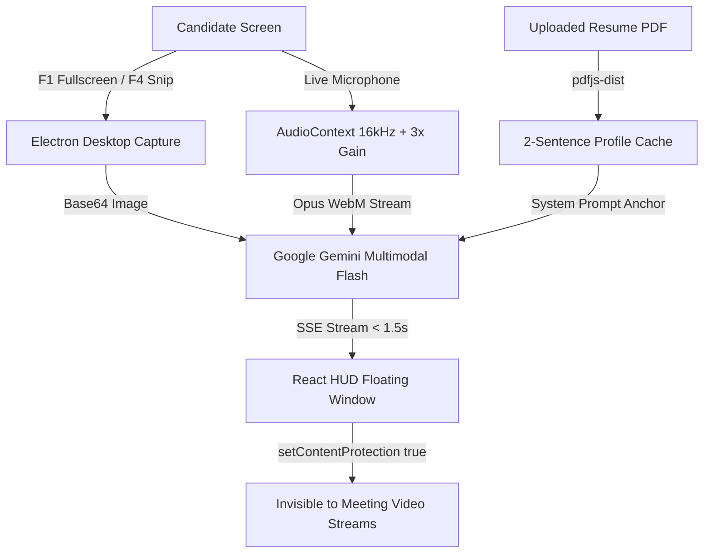
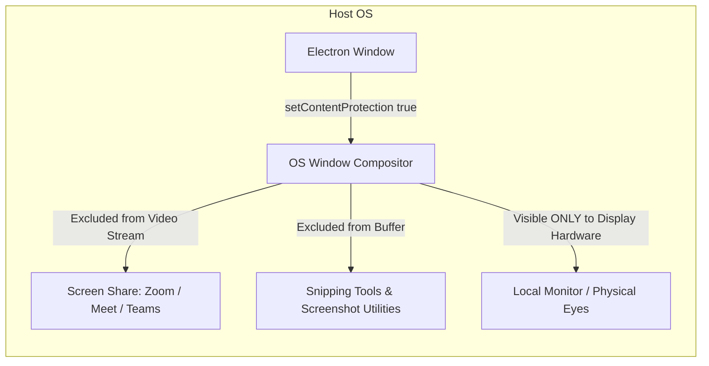
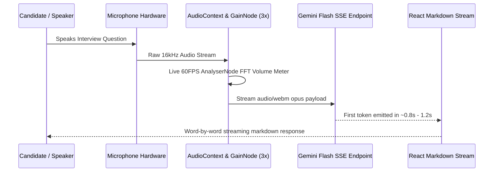
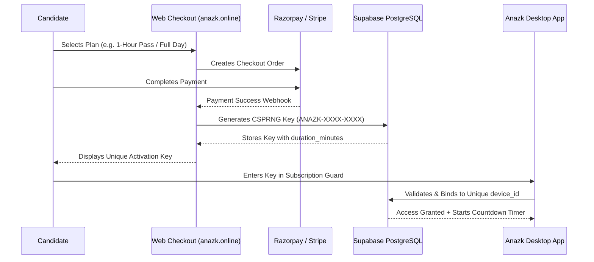

<div align="center">

# 🕶️ Anazk AI (cheaterBoy)

### *Invisible Live Interview Copilot & AI Problem-Solving Assistant*

[](package.json)
[](#-tech-stack)
[](https://electronjs.org)
[](https://reactjs.org)
[](https://tailwindcss.com)
[](https://deepmind.google/technologies/gemini/)
[](LICENSE)

<p align="center">
  <b>An undetectable floating HUD overlay designed for real-time interview copiloting, automated live coding solutions, screen OCR, and resume-tailored instant responses in &lt; 1.5 seconds.</b>
</p>

---

</div>

## 📑 Table of Contents

- [✨ Key Highlights](#-key-highlights)
- [⚡ Core Features & Capabilities](#-core-features--capabilities)
- [🛡️ Anti-Detection & Stealth Architecture](#️-anti-detection--stealth-architecture)
- [🎙️ Real-Time Voice Streaming & Audio Engine](#️-real-time-voice-streaming--audio-engine)
- [📄 Resume Personalization System](#-resume-personalization-system)
- [💳 Licensing & Payment Architecture](#-licensing--payment-architecture)
- [⌨️ Global Hotkeys & Controls](#️-global-hotkeys--controls)
- [🛠️ Tech Stack](#️-tech-stack)
- [🚀 Getting Started](#-getting-started)
  - [Prerequisites](#prerequisites)
  - [Installation](#1-installation)
  - [Environment Configuration](#2-environment-configuration)
  - [Supabase Database Setup](#3-supabase-database-setup)
  - [Development Mode](#4-run-in-development)
  - [Production Packaging (.exe)](#5-package-production-executables)
- [🔒 Security & Fair Use Disclaimer](#-security--fair-use-disclaimer)

---

## ✨ Key Highlights

- 🥷 **Hardware-Level Screen-Share Immunity:** Zero visibility on Zoom, Google Meet, Microsoft Teams, Webex, Discord, or Proctoring software via OS window compositor flags.
- ⚡ **Sub-1.5s First-Token Streaming:** Server-Sent Events (SSE) word-by-word streaming powered by Google Gemini Flash.
- 📸 **Instant Snipping & Fullscreen OCR:** Capture any coding question, MCQ, or architecture diagram with global shortcuts (`F1` / `F4`).
- 🎯 **Smart Resume Caching:** Automatic PDF/Doc parsing with compact 2-line profiling (~30 tokens prefill) to personalize responses to your real career experience without latency degradation.
- 🎚️ **60 FPS Real-Time Volume Meter:** Live `AnalyserNode` mic feedback with 3x hardware gain booster.
- 🚨 **F2 Boss Key (Panic Switch):** Instant 10ms emergency hide/show toggle with no taskbar presence.

---

## ⚡ Core Features & Capabilities



### 1. Ultra-Stealth Floating HUD
- Frameless, translucent HUD overlay with zero branding or watermarks.
- Adjustable opacity (20% to 100%) and draggable top bar.
- Always pinned on top of target code editors (VS Code, LeetCode, HackerRank, IDEs).

### 2. Dual Capture Modes
- **`F1` Fullscreen OCR:** Captures the primary display and extracts code, questions, or system design prompts automatically.
- **`F4` Crosshair Snip:** Interactive overlay allows drawing a bounding box around any exact question or diagram on screen.

### 3. Voice Copilot (Interview Mode)
- Continuously listens or pushes to talk.
- Filters background noise and applies real-time gain boosting.
- Transcribes and responds verbatim with conversational, concise answers tailored to senior-level engineering standards.

---

## 🛡️ Anti-Detection & Stealth Architecture

Anazk AI utilizes operating system window compositor flags to guarantee privacy:



| Security Layer | Implementation Mechanism | Benefit |
|---|---|---|
| **Screen Capture Immunity** | `mainWindow.setContentProtection(true)` | Completely blacked out / omitted from all screen sharing sessions and video captures. |
| **Taskbar Stealth** | `skipTaskbar: true` (Boss Mode) | Removed from the Windows taskbar and Alt+Tab switchers when minimized. |
| **Hotkeys Hook** | `globalShortcut.register` | Direct OS-level keyboard interception that operates even when the app is out of focus. |
| **Zero Forensic Trace** | In-memory token streaming | No question logs or audio snippets are saved to disk unencrypted. |

---

## 🎙️ Real-Time Voice Streaming & Audio Engine

The voice engine is built on the HTML5 Web Audio API with a low-latency pipeline:



1. **Automatic Device Enumeration:** Detects and binds to active microphone hardware (Senary, Realtek, USB headsets).
2. **Visual Volume Meter:** Dynamic 60 FPS audio visualizer (`Vol: 85% [ ▂▃▅▆▇ ]`) provides instant reassurance that your voice is being captured.
3. **SSE Word-by-Word Streaming:** Utilizes `streamGenerateContent?alt=sse` to stream responses in real-time, eliminating wait time.

---

## 📄 Resume Personalization System

Anazk AI tailors AI-generated interview answers to match your real background:

1. **Client-Side Extraction (`pdfjs-dist`):** Parses raw text from your uploaded PDF or Word document in seconds.
2. **Compact Profile Caching:** Automatically summarizes your resume into an ultra-dense **2-sentence Candidate Profile**:
   ```
   Candidate Profile: Senior Full-Stack Engineer | React, TypeScript, Node.js, Python, PostgreSQL, AWS | 5+ yrs building high-throughput microservices.
   ```
3. **Zero-Latency Overhead:** Requiring only ~30 prompt tokens, this enables **< 1.5s first-token response times** while ensuring answers reference your actual experience, tools, and project history.

---

## 💳 Licensing & Payment Architecture

Anazk AI includes an end-to-end monetization and license verification engine:



- **Format:** `ANAZK-[4 CHARS]-[4 CHARS]` (e.g., `ANAZK-9K4F-28XP`).
- **Device Locking:** Bound to the user's hardware fingerprint upon first activation to prevent key sharing.
- **Owner VIP Bypass:** Built-in cryptographic master key for development and administrative access.

---

## ⌨️ Global Hotkeys & Controls

| Shortcut | Function | Description |
|---|---|---|
| <kbd>F1</kbd> | **Fullscreen OCR & Solve** | Instantly captures entire screen and generates AI solutions. |
| <kbd>F4</kbd> | **Region Snip Tool** | Spawns interactive crosshair to select a question bounding box. |
| <kbd>F3</kbd> | **Ask AI / Re-evaluate** | Triggers AI generation on the currently active context. |
| <kbd>F2</kbd> | **Boss Key (Panic Switch)** | Toggles app visibility in < 10ms with zero traces. |
| <kbd>F12</kbd> | **Diagnostic Inspector** | Opens developer tools and real-time audio log drawer. |
| **`🎙️ Voice`** | **Voice Mode** | Starts real-time microphone transcription & response. |
| **`Test Mic`** | **Hardware Audio Check** | Verifies volume input levels locally without making API calls. |
| **`⚙️ Settings`** | **Preferences** | Upload resume, switch audio input device, or modify opacity. |

---

## 🛠️ Tech Stack

- **Desktop Framework:** [Electron 25](https://www.electronjs.org/) (Chromium + Node.js)
- **Frontend Layer:** [React 18](https://react.js.org/) + [Vite 4](https://vitejs.dev/)
- **Styling & Layout:** Vanilla CSS + [TailwindCSS 3](https://tailwindcss.com/)
- **Primary AI Engine:** [Google Gemini Flash](https://deepmind.google/technologies/gemini/) (`gemini-flash-latest`, `gemini-3.5-flash`, `gemini-3.7-flash`)
- **Secondary AI Engine:** [Groq LPU](https://groq.com/) (`llama-3.3-70b-versatile`)
- **Document Processing:** [`pdfjs-dist`](https://mozilla.github.io/pdf.js/)
- **Database & Auth:** [Supabase](https://supabase.com/) (PostgreSQL + RLS)
- **Payment Gateways:** [Razorpay](https://razorpay.com/) & [Stripe](https://stripe.com/)
- **Packaging:** [`electron-builder`](https://www.electron.build/) (NSIS Installer + Standalone Portable EXE)

---

## 🚀 Getting Started

### Prerequisites
- [Node.js](https://nodejs.org/) (v18.x or v20.x recommended)
- [npm](https://www.npmjs.com/) (v9 or higher)
- Windows 10/11, macOS, or Linux

### 1. Installation
```bash
# Clone the repository
git clone https://github.com/prince-up/Anazkai.git
cd cheaterboy

# Install all dependencies
npm install
```

### 2. Environment Configuration
Create a `.env` file in the root directory:
```env
# Supabase Configuration
VITE_SUPABASE_URL=https://your-project.supabase.co
VITE_SUPABASE_ANON_KEY=your-anon-key
SUPABASE_SERVICE_ROLE_KEY=your-service-role-key

# Payment Credentials
RAZORPAY_KEY_ID=your_razorpay_key_id
RAZORPAY_KEY_SECRET=your_razorpay_key_secret
VITE_RAZORPAY_KEY_ID=your_razorpay_key_id

# Master VIP Bypass Key
VITE_OWNER_MASTER_KEY=ANAZK-OWNER-VIP-2026
```

### 3. Supabase Database Setup
Execute the idempotent setup script in your [Supabase SQL Editor](https://supabase.com/dashboard):
```sql
-- Creates licenses table with device locking
CREATE TABLE IF NOT EXISTS public.licenses (
  id                UUID PRIMARY KEY DEFAULT gen_random_uuid(),
  key               TEXT UNIQUE NOT NULL,
  duration_minutes  INTEGER NOT NULL DEFAULT 60,
  status            TEXT NOT NULL DEFAULT 'unused',
  activated_at      TIMESTAMPTZ,
  device_id         TEXT,
  email             TEXT,
  created_at        TIMESTAMPTZ DEFAULT NOW(),
  updated_at        TIMESTAMPTZ DEFAULT NOW()
);

ALTER TABLE public.licenses ENABLE ROW LEVEL SECURITY;
CREATE POLICY "Allow public access" ON public.licenses FOR ALL USING (true);
```

### 4. Run in Development
```bash
# Option A: Single command with automatic hot reload
npm run dev:all

# Option B: Run in separate terminals
# Terminal 1:
npm run dev
# Terminal 2:
npm run electron:start
```

### 5. Package Production Executables
To generate standalone Windows `.exe` installers:
```bash
npm run dist
```
The output will be saved in `dist-electron/`:
- 📦 **`AnazkAI 1.0.0.exe`** — Portable single-file executable (run anywhere without installation).
- 💿 **`AnazkAI Setup 1.0.0.exe`** — Standard Windows NSIS Setup Installer.

---

## 🔒 Security & Fair Use Disclaimer

> [!IMPORTANT]
> **Educational & Productivity Notice:**  
> Anazk AI is developed strictly for study assistance, interview mock preparation, and developer productivity enhancement. Users are solely responsible for ensuring compliance with the terms of service and academic integrity policies of any platform, employer, or testing institution.

---

<div align="center">

Made with ❤️ by [prince-up](https://github.com/prince-up) • Contributions & Pull Requests welcome!

</div>
