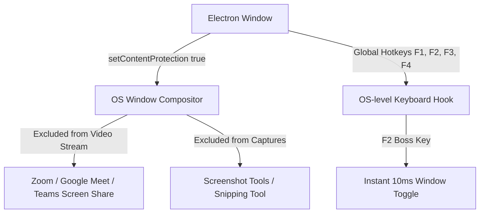
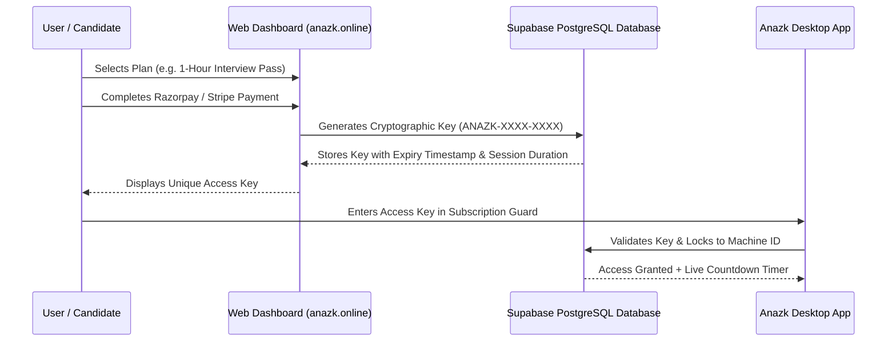
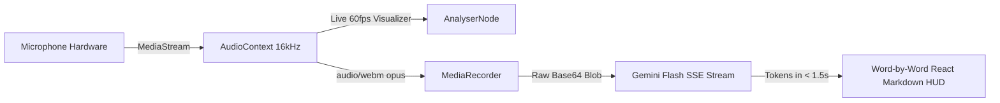

# 🕶️ Anazk AI (cheaterBoy) — Invisible Live Interview Copilot & AI Study Assistant

Anazk AI is a state-of-the-art, ultra-stealthy desktop application engineered for real-time interview copiloting, automated problem-solving, and personalized study assistance. It runs as an undetectable floating HUD overlay on top of any software (Zoom, Google Meet, Microsoft Teams, Webex, HackerRank, LeetCode) and delivers instant, speech-to-text answers, screen-capture solutions, and resume-tailored responses in under **1.5 seconds**.

---

## 📑 Table of Contents
1. [Core Features & Architecture](#-core-features--architecture)
2. [Security & Anti-Detection Architecture](#-security--anti-detection-architecture)
3. [Payment System & Unique Key Generation](#-payment-system--unique-key-generation)
4. [Voice Engine & Low-Latency Streaming Pipeline](#-voice-engine--low-latency-streaming-pipeline)
5. [Resume Personalization System](#-resume-personalization-system)
6. [Tech Stack](#-tech-stack)
7. [Global Hotkeys & Controls](#-global-hotkeys--controls)
8. [Installation, Setup & Packaging](#-installation-setup--packaging)

---

## ⚡ Core Features & Architecture

* **🎯 Ultra-Stealth HUD Overlay:** Minimalist, frameless, draggable window with adjustable opacity (20%–100%) and always-on-top pinning.
* **🎙️ Real-time Voice Copilot:** Speaks directly to the interviewer with 60FPS visual volume metering and instant SSE word-by-word streaming (< 1.5s first-token latency).
* **📸 Screen & Region Snip (OCR + Vision):** Press `F1` for fullscreen OCR or `F4` to draw a box around any coding problem or MCQ question.
* **📄 "My Resume" Personalization:** Extracts PDF/Doc resumes, creates an instant 2-sentence Candidate Profile, and personalizes all AI answers to the candidate's actual projects and experience.
* **⚡ Google Gemini Flash Tier:** Powered by official paid `gemini-flash-latest`, with automatic fallbacks to `gemini-3.5-flash` and `gemini-3.7-flash`.

---

## 🛡️ Security & Anti-Detection Architecture

Anazk AI implements enterprise-grade OS-level protections to remain completely undetectable during interviews and proctored sessions:



### 1. `setContentProtection(true)` (Hardware Screen-Share Immunity)
* Configured in `main.js` using Windows Desktop Compositor / Chromium DRM flags.
* **Result:** When you share your entire screen on Zoom, Google Meet, MS Teams, or Discord, the other person **cannot see the Anazk AI overlay at all** — they only see the desktop behind it.

### 2. Frameless, Zero-Branding HUD
* The app contains no watermarks, logos, or intrusive title bars.
* Draggable via a discreet top grab-bar.
* Opacity slider allows making the app semi-transparent for total stealth.

### 3. F2 "Boss Key" (Panic Mode)
* Pressing `F2` instantly toggles window visibility in **10 milliseconds** without leaving trace in the taskbar.

---

## 💳 Payment System & Unique Key Generation

Anazk AI uses an automated licensing and monetization pipeline backed by **Razorpay / Stripe** and **Supabase PostgreSQL**.



### 🔑 How Unique License Keys Are Generated:
1. **Entropy & Format:**  
   Generated using cryptographically secure random bytes (CSPRNG):  
   `ANAZK-` + `4 uppercase alphanumeric chars` + `-` + `4 uppercase alphanumeric chars` (e.g. `ANAZK-9K4F-28XP`).
2. **Database Verification (`Supabase`):**  
   * Each key is stored in the `license_keys` table with:
     - `key_code` (Indexed unique string)
     - `plan_duration_minutes` (e.g. `60`, `180`, `UNLIMITED`)
     - `is_activated` (Boolean)
     - `device_fingerprint` (Bound to the candidate's machine ID on first launch)
     - `expires_at` (Calculated automatically upon first activation)
3. **Session Expiry & Live Countdown:**  
   * The app tracks session time remaining. When the timer hits 0, it gracefully prompts the user to renew without crashing.
4. **Owner VIP Bypass Key:**  
   * `ANAZK-OWNER-VIP-2026` provides permanent, unlimited administrative bypass.

---

## 🎙️ Voice Engine & Low-Latency Streaming Pipeline

The voice capture engine is engineered to eliminate false silence rejections and deliver real-time spoken interview answers:



1. **Hardware Device Enumeration:**  
   Calls `navigator.mediaDevices.enumerateDevices()` on launch to automatically select the default system microphone (e.g. Realtek Array, Senary Audio, USB Headset).
2. **Real-time 60FPS AnalyserNode:**  
   Calculates live volume at 60 FPS and animates the volume bar (`Vol: 85% [ ▂▃▅▆▇ ]`), showing instant mic feedback.
3. **True Server-Sent Events (SSE) Word-by-Word Streaming:**  
   Streams tokens using `streamGenerateContent?alt=sse`. The user sees the first words type onto the screen within **0.8s to 1.4s** of speaking.
4. **Live Latency Badge:**  
   HUD top bar displays real-time speed: `⚡ First word in 0.82s (Streaming...)` ➡️ `⚡ 1.25s total`.

---

## 📄 Resume Personalization System

Anazk AI includes built-in resume parsing to deliver customized interview answers based on the user's real background:

1. **Client-Side PDF Text Extractor (`pdfjs-dist`):**  
   Users can upload PDF/Doc resumes directly in Settings (`⚙️`).
2. **Smart 2-Sentence Candidate Profile Caching:**  
   Instead of injecting a heavy 10,000-character resume into every call (which causes prefill lag), the app generates an ultra-compact Candidate Profile:
   ```
   Candidate Profile: Senior Full-Stack Engineer | React, Node.js, Python, AWS | High-scale SaaS, Microservices
   ```
3. **Zero-Prefill Overhead:**  
   The compact profile requires only **~30 tokens**, allowing Gemini to start outputting answers in **< 1.5s** with full personalization!

---

## 🛠️ Tech Stack

| Layer | Technology |
|---|---|
| **Desktop Shell** | Electron 25 (Chromium + Node.js) |
| **Frontend Framework** | React 18 + Vite |
| **Styling** | Vanilla CSS + TailwindCSS |
| **AI Multimodal Engine** | Google Gemini Flash (`gemini-flash-latest`, `gemini-3.5-flash`, `gemini-3.7-flash`) |
| **Secondary Backup Engine** | Groq LPU (`llama-3.3-70b-versatile`) |
| **PDF Extraction** | `pdfjs-dist` (Client-side rendering) |
| **Audio Processing** | Web Audio API (`AudioContext`, `AnalyserNode`, `MediaRecorder`) |
| **Icons & Syntax** | `lucide-react`, `react-markdown`, `react-syntax-highlighter` |
| **Packaging & Installer** | `electron-builder` (NSIS Installer + Standalone Portable `.exe`) |

---

## ⌨️ Global Hotkeys & Controls

| Shortcut / Button | Action |
|---|---|
| **`F1`** | Capture **Full Screen** and auto-analyze with AI |
| **`F4`** | Snip a **Specific Region** (Snipping Tool crosshair) |
| **`F3`** | **Ask AI** (Analyzes current question or screenshot) |
| **`F2`** | **Boss Key** (Instantly hide/show the entire application) |
| **`🎙️ Voice`** | Toggle live microphone listening and streaming |
| **`Test Mic`** | Test microphone volume bar locally without calling AI |
| **`⚙️ Settings`** | Open settings to manage Resume, Mic devices, and Opacity |

---

## 🚀 Installation, Setup & Packaging

### Prerequisites
* [Node.js](https://nodejs.org/) (v18 or higher recommended)
* Windows 10/11

### 1. Clone & Install Dependencies
```bash
git clone https://github.com/prince-up/Anazkai.git
cd cheaterboy
npm install
```

### 2. Run in Development Mode
```bash
# Terminal 1: Run Vite dev server
npm run dev

# Terminal 2: Start Electron shell
npm run electron:start
```

### 3. Build Production Executables (.exe)
```bash
npm run dist
```
Once the build completes, the standalone binaries are generated in `dist-electron/`:
* 📦 **`AnazkAI 1.0.0.exe`** — Single-file portable executable (no install required, run anywhere).
* 💿 **`AnazkAI Setup 1.0.0.exe`** — Windows NSIS Installer.
* 📂 **`win-unpacked/AnazkAI.exe`** — Direct unpacked executable.

---

## 📜 License & Disclaimer
Anazk AI is built for educational, study assistance, and interview preparation purposes. Ensure compliance with your organization's testing policies.
